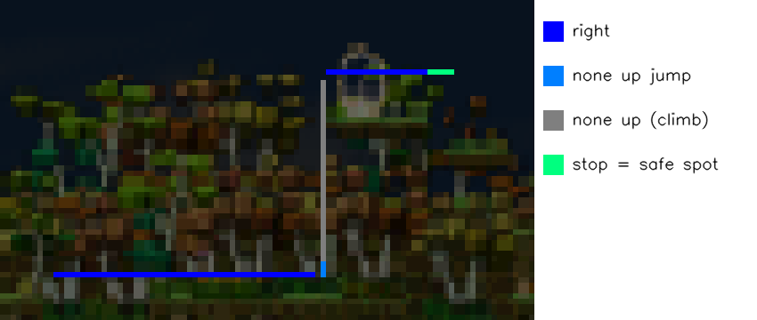

# wingpu 平台（遊戲在 wingpu VM 裡，bot 在該 VM 的腳本容器裡）

遊戲（MapleStory Worlds / Artale）跑在 wingpu 主機上的 Windows VM；bot 跑在那台 VM 的**腳本容器**（Linux，2 CPU / 2 GB）。
畫面從 wingpu SDK 讀（`/wingpu/frame`，整個 guest 螢幕），按鍵 / 滑鼠經 `/wingpu/input.sock` 送進 guest。
這個 fork（`wingpu-backend` 分支）由我們維護；上游已停更。

**bot 直接用遊戲的真實解析度**（全螢幕 1366x768、1920x1080……或視窗模式的 client 區），不再縮放成上游的 1282x693。
模板與像素設定在啟動時、以及解析度改變時，依畫面大小自動縮放（下面「解析度」）。

| 上游（Windows） | wingpu |
|---|---|
| `GameWindowCapturor`（抓視窗、縮放成 1296x700） | `src/input/GameWindowCapturorForWingpu.py`：整個 guest 畫面 → 找遊戲 client 區 → **1:1 裁切**（全螢幕時就是整個畫面，不複製） |
| pyautogui `keyDown/keyUp`、`press_key` | `src/input/WingpuKeyboard.py`：pyautogui 鍵名 → `KeyboardEvent.code`（`KEY_MAP`），**dry run 預設開** |
| `click_in_game_window` | client 座標 + client 原點 = guest 座標（1:1），`vm.click`（同樣受 dry run 管） |
| `activate_game_window` / `resize_window` | 不做事（容器看不到也動不了 guest 的視窗；遊戲要自己在前景） |
| pynput 熱鍵、OpenCV 視窗 | `src/input/WingpuControl.py`：網頁 UI、`control.json`、debug 圖 |
| — | `src/utils/resolution.py`：解析度縮放；`src/utils/config_layers.py`：設定分層；`src/input/WingpuWebUI.py` + `webui/index.html`：網頁 UI |

平台選擇（`src/utils/common.py` `get_platform()`）：環境變數 `WINGPU=1/0` > config `system.platform` > auto（Linux 上有 `/wingpu/frame` 就是 wingpu）。

## 設定分層

`config_default.yaml` → `config_wingpu.yaml` → `config_<--cfg>.yaml` → **`/work/msbot_config.yaml`**（網頁 UI 存的，最後一層）。
內建的 `config/*.yaml` 不會被網頁改。刪掉 `/work/msbot_config.yaml` 就回到內建設定（網頁「清除我的設定」會留 `.bak`）。
路徑可用環境變數 `MSBOT_USER_CONFIG` 改。

## 部署到容器（`tools/wingpu_sync.sh`）

在有這個 repo 的機器上（開發機 Git Bash 或 .63）：

```sh
git commit ...                                   # 只部署 commit 過的東西
tools/wingpu_sync.sh                             # = HEAD -> wingpu-ct-maple（ssh test@192.168.66.63）
tools/wingpu_sync.sh <commit|branch> <container> <ssh host>   # 其他容器 / 主機；ssh host 給 "" = 本機 docker
```

它把 commit 打成 git bundle 送進容器，`/work/MapleStoryAutoLevelUp` 變成那個 commit 的 git checkout（detached HEAD）：
追蹤的檔案和 commit 完全一樣，`log/`、`screenshot/` 這類未追蹤的檔案保留。第一次會把舊的純複本移到
`MapleStoryAutoLevelUp.old-<時間>`。使用者狀態（`/work/msbot_config.yaml`、`/work/control.json`、`/work/debug/`）不在程式目錄裡，部署不會動到。
部署完要重新啟動 bot 才會載入（網頁「重新啟動」，或 `curl -X POST http://<容器 IP>:8765/restart`）。
容器裡看目前版本：`git -C /work/MapleStoryAutoLevelUp log -1 --oneline`。

第一次安裝 venv（容器映像已有 Python 3.12、numpy、opencv-headless、pyyaml 和 `import wingpu`）：

```sh
python3 -m venv --system-site-packages /work/venv-msbot
/work/venv-msbot/bin/pip install -r /work/MapleStoryAutoLevelUp/requirements-wingpu.txt
```

## 在管理頁開關（wingpu App）

這個 repo 最上層的 `wingpu-app.yaml` 讓 bot 成為容器的 **App**（wingpu repo `docs/CONTAINERS.md`「App」）：
`tools/wingpu_sync.sh` 部署時建立 `/work/apps/msbot` → `/work/MapleStoryAutoLevelUp`，管理頁 VM 的「App」分頁就有
「楓之谷練功 Bot」：開 / 關、重新啟動、記錄、「VM 開機時自動啟動」、「當掉自動重啟」，下面是 bot 的網頁（:8765）。

- 啟動 = `tools/wingpu_app_run.sh`：寫 `/work/control.json {"run": false}`（**一律停在暫停**，網頁按「開始」才動），再
  `exec /work/venv-msbot/bin/python -m src.engine.MapleStoryAutoLevelUp --cfg $MSBOT_CFG`（manifest 的 `env` 設 `wingpu_maple`）。
  log 在管理頁的「記錄」（`/work/logs/<run>-app-msbot.log`）。
- 關 = SIGTERM：bot 放開所有按鍵再結束（10 秒沒結束才 SIGKILL，之後平台也會放開它按著的鍵）。網頁的「結束」= 正常結束（exit 0，
  不會被自動重啟）；網頁的「重新啟動」是同一個 PID 的 `execv`，管理頁看到的還是同一個 run。
- 管理頁的 **「禁止送輸入」** 打開時，bot 的每個按鍵 / 點擊都會被 wgsd 擋下（`input blocked`），平台會放開 bot 按著的鍵；
  bot 繼續跑但送不出東西，log 每 30 秒記一次 warning。按下失敗的鍵不算「按著」，恢復允許後會再按。
- 舊的方式（`docker exec -d wingpu-ct-maple /work/scripts/run_bot.sh`）還能用，但那樣啟動的 bot 管理頁看不到、關不掉。

## 執行

```sh
cd /work/MapleStoryAutoLevelUp
/work/venv-msbot/bin/python -m src.engine.MapleStoryAutoLevelUp --cfg wingpu_maple
```

從主機背景啟動（log 在 `/work/logs/msbot_run.log`）：

```sh
docker exec -d wingpu-ct-maple sh -c "cd /work/MapleStoryAutoLevelUp && exec /work/venv-msbot/bin/python \
  -m src.engine.MapleStoryAutoLevelUp --cfg wingpu_maple > /work/logs/msbot_run.log 2>&1"
```

一律 headless。SIGINT / SIGTERM 會放開所有按著的鍵再結束。網頁的「重新啟動」是 `os.execv` 同一個程式（PID 不變，容器不重開），
重新讀所有設定，**並回到 dry run**（命令列的 `--wingpu_live` 也會被拿掉），除非使用者在網頁勾了「記住」。

## 網頁 UI（`wingpu.http_port`，maple 是 8765）

`http://<容器 IP>:8765/`（maple 容器現在是 `10.231.0.14`，容器網路不對外）；wgsd 會把 `/app/<vm>/...` 代理過來。
繁體中文、手機可用。內容：

- 畫面：bot 標註過的偵測圖（每秒更新的 `./debug.jpg`，或勾「串流」用 `./mjpeg`）。
- 控制：開始 / 暫停（放開所有鍵、只看不動）/ 重新啟動 / 結束。
- 狀態：狀態機、小地圖 / 玩家有沒有找到與命中率、怪物數、指令、解析度與縮放、每秒張數、CPU、HP/MP/EXP、最近的（模擬）動作、「偵測不到：停手中」。
- **模擬 / 真的輸入開關**：預設模擬。切到真的輸入要在對話框按確認（伺服器端也要 `confirm: "LIVE"`）；
  不勾「記住」時只到 bot 重新啟動為止，勾了才寫 `wingpu.dry_run: false` + `wingpu.remember_live: true` 到使用者設定。
- 設定：地圖（`minimaps/` 裡、`config_data.yaml` 有怪物資料的）、路線（`route.files`，不勾 = 全部）、模式、攻擊方式、按鍵、
  Buff、喝水門檻與間隔、玩家偵測方式、攻擊範圍、怪物偵測與找怪範圍、偵測不到幾秒停手、每秒處理張數。按鍵名稱用 `WingpuKeyboard.KEY_MAP` 驗證，
  錯誤會標在欄位下。「儲存並套用」= 存檔 + 重新啟動 bot。
- **Buff 編輯**：一列一個 Buff：名稱（可空）、按鍵、冷卻秒數、啟用、啟動時先放。存成引擎原本讀的 `buff_skill.keys` / `cooldown`
  （只有啟用的）加 `cast_at_start` / `names`；全部的列（含停用的）另存在 `buff_skill.items`，之後可以再打勾啟用。
  狀態區顯示每個 Buff 還有幾秒放、上次放是幾秒前（模擬時是「會放」）。偵測不到玩家停手時 Buff 也不放。
- **截取名牌**：「取一張畫面」把 bot 剛處理的那張凍結下來；有隊伍紅條時自動框出紅條下面的名字（找白色文字），
  沒有就自己在畫面上拖框（可放大 2×/3×，手機可用手指拖）。「存成名牌」存到 `/work/nametag/nametag.png` + `nametag.json`
  （當時的縮放、名牌左上角到玩家中心的位移——有隊伍紅條時用紅條的玩家位置校正），並在那張畫面上自我測試；bot 2 秒內換用新模板，不用重啟。

給反向代理的假設：

- 頁面只用相對網址（`./status`、`./api/config`），沒有外部 CDN；代理要**去掉前綴**，而且 `/app/<vm>`（沒有結尾斜線）要轉址到 `/app/<vm>/`
  （頁面自己也會補斜線）。
- 沒有 WebSocket。`./mjpeg` 是長時間的串流回應（`multipart/x-mixed-replace`，沒有 Content-Length）：代理要邊收邊送、不能整個 buffer；
  不支援也沒關係，預設是每秒 GET 一次 `./debug.jpg`。
- POST body 是小 JSON，伺服器上限 64 KB。

API：`GET ./status`、`./debug.jpg`、`./guest.jpg`、`./route.png`、`./mjpeg`、`./api/config`、`./api/nametag`、
`./api/nametag/template.png`、`./api/nametag/snapshot.jpg?id=`；`POST ./api/nametag/snapshot`、`./api/nametag/save`（`{"id", "rect": [x,y,w,h]}`）、`./api/nametag/delete`；
`POST ./run`、`./pause`、`./restart`、`./quit`、`./api/config`（`{"values": {"key.jump": "alt", ...}}`）、`./api/config/reset`、
`./api/live`（`{"live": true, "confirm": "LIVE", "remember": false}`）。

`control.json`（每 0.5 s 檢查）照舊可用：`{"run": false}` 暫停、`{"run": true}` 繼續、`{"quit": true}` 結束。

## 解析度（`src/utils/resolution.py`）

模板（`monster/`、`nametag/`、`rune/`、`misc/`）與 `config_default.yaml` 的像素數字都是在上游的 1296x700 工作畫面上做的。
bot 拿到第一張畫面（以及畫面大小改變時）會：

- 算縮放 `s`：`wingpu.scale: "auto"` = 畫面寬 / 1296（1366x768 → 1.054）。可設 `"height"`、`"geometric"` 或數字。
  2026-11-02 在 maple 量：怪物模板在 s = 1.000 / 1.030 / **1.054** / 1.066 / 1.075 / 1.097 的中位分數 0.18 / 0.11 / **0.07** / 0.085 / 0.087 / 0.10，
  小地圖對 map.png 1.056；以高度算（1.097）明顯較差。
- 把長度類設定乘上 `s`（攻擊範圍、角色大小、隊伍紅條位移、找怪外擴、符文框……），面積乘 `s²`；畫面上的 UI 位置依錨點換算
  （底部 UI 帶 `ui_y_start` 從下緣算、符文訊息從上方置中、符文箭頭置中）；寫死在程式裡的像素（紅條高 5–7、血條面積、Hough 半徑……）也一起縮放。
  網頁顯示與儲存的都是**未縮放**的值。
- 模板用 `scale_template` 縮放（綠色背景 (0,255,0) 保持精確，遮罩照舊）。
- 小地圖另外量：小地圖本身也隨解析度縮放，而 `route*.png` / `map.png` 是小地圖像素。bot 量出 live 小地圖對 `map.png` 的比例 `m`
  （用邊緣強度比對，因為小地圖視窗是半透明的、背景會隨後面的遊戲畫面變），把小地圖縮回 route 尺寸再找位置，玩家點座標除以 `m`。
  量不到時先用 `s`。

顏色：沒有 OS 縮放了，UI 是精確的——小地圖白框 255、玩家點 (136,255,255)、怪物血條 (71,204,64) 都精確存在。
但遊戲把世界畫成約 1.05 倍（有濾波），**怪物輪廓不再是純黑**：上游的 `contour_only` 在 wingpu 上不能用（見「驗證」），改用 `color`。

## 找玩家：隊伍紅條 / 名牌 / 自動（`player_detect`）

- `party_bar`：隊伍裡的角色頭上的紅色 HP 條（要組隊）。最準，幾乎不花 CPU。
- `nametag`：角色腳下的名字。名字後面的底框是半透明的（會透出後面的場景），所以比對的是名字的**白色文字**
  （`src/utils/nametag.py`，TM_SQDIFF_NORMED）：上次找到後 1 秒內只在附近找（便宜），找不到才全畫面找（先 1/2 大小再細找）。
  模板用網頁「截取名牌」做；換解析度時依縮放比例自動縮放。門檻 `nametag_thres` 0.3（實測本人 0.00–0.20，其他東西 0.45 以上）。
- `auto`（wingpu 預設）：先找紅條，找不到才用名牌。狀態顯示這張是哪個方法找到的。
- 舊的 `nametag.enable: True` 仍是上游的名牌程式。

## 找怪範圍（`monster_detect.search`）

- `roi`（wingpu 預設）：玩家周圍的框，`roi_left/right/up/down`（參考像素，會縮放；預設 400/400/150/150），畫在 debug 圖上（Mob Detection Box）。
- `full`：整個遊戲畫面（UI 帶以上）。
- `attack`：上游的「攻擊範圍 + search_box_margin」。

## 練功 / 休息循環（`hunt_cycle`，預設關）

練功一段時間（`hunt_minutes` [最少, 最多] 分鐘，每輪隨機）→ 休息一段時間（`rest_minutes`）→ 再練功。網頁「設定 → 練功 / 休息循環」。
狀態區顯示階段（練功 / 前往安全點 / 休息 / 不在時段內 / 已結束）、這階段還剩多久、第幾輪、這次玩了多久。

休息方式 `rest_action`：
- `stop` 原地停手：放開所有鍵，不移動、不攻擊、不放 Buff；**血 / 魔低了照樣喝水**。
- `safe_spot` 走到安全點：在網頁的小地圖上點安全點（每張地圖一個，存 `hunt_cycle.safe_spots`），然後照「安全路線」走過去，
  到了（小地圖上 ±3 / ±4 像素內）就停手休息；`safe_spot_timeout` 秒內沒到就原地休息並記在 log。休息完回到練功路線（照原本的路線邏輯走回去）。
  - 安全路線 = `/work/routes/<地圖>/route_safe.png`（不放在 `minimaps/`，那裡的 route*.png 都是練功路線），跟練功路線**同一套顏色**，
    在網頁上用畫筆畫（可以疊著看練功路線、有顏色圖例、橡皮擦、筆寬、放大）。
  - 沒有安全路線時：安全點跟角色在同一層（小地圖 y 差 ±4 內）就直接左右走過去；不同層就原地休息，log「沒有安全點路線」。
- `go_home` 回城後結束：按 `key.return_home` 一次，然後這次就結束（bot 不再送任何東西，狀態顯示「已結束」；要再開始按「重新啟動」）。

另外可設：總共玩幾小時後結束（`session_hours`，0 = 不限）、每天的時段（`window_start` / `window_end`，HH:MM，可跨午夜；不在時段內就停手等）。

和其他功能：偵測不到玩家的停手在每個階段都有效；休息、前往安全點時不放 Buff；「多久沒攻擊 / 卡住」的看門狗只在練功時算，回到練功時重新計時。

### 怎麼畫爬繩子 / 梯子的安全路線



1. 地面：從練功區塗「右」（或「左」）一路到繩子正下方。
2. 繩子底下 1–3 格：塗「跳上繩子」（湛藍 `0,127,255` = `none up jump`：按住上同時跳）。繩子摸不到時一定要這格；摸得到的繩子 / 梯子塗「往上爬」也行。
   （上游的地圖沒有這個顏色：它們的繩子底下大多是「左跳 / 右跳」或直接是灰色；`none up jump` 是這個 fork 加的，鍵盤控制器本來就會「按住上 + 按跳」。）
3. 整條繩子：塗「往上爬」（灰 `127,127,127`）。
4. 繩子頂端接上平台：在平台上塗「左」或「右」。爬到頂附近時，上游的梯子邏輯會「繼續按上、同時往平台方向」（測試：`right up none`），上去之後就照平台上的顏色走。
5. 安全點那格塗「停」（淺綠），並用「設安全點」點在同一格。

`tests/test_safe_route.py` 用合成的安全路線檢查每個位置的指令（地面 → `right none none`、繩子下 → `none up jump`、繩子上 → `none up none`、
接近頂端 → `right up none`、平台 → `right none none`），以及鍵盤控制器把 `none up jump` 變成「按住上 + 按跳」。
**實際爬繩子只能在真的輸入時驗證：第一次用安全點路線上線時請在旁邊看著。**

## 時間設定都在網頁上改

所有跟時間有關的設定都在網頁上（單位寫在欄位名稱上，超出範圍會標紅字）：練功 / 休息分鐘、走到安全點的秒數、總時數、每日時段、
偵測不到停手秒數、卡住看門狗、多久沒攻擊、定時換頻道間隔、Buff 冷卻 / 攻擊後多久放 Buff、喝水間隔與檢查頻率、沒藥回城秒數、
範圍技 / 瞬移 / 攻擊間隔、符文、巡邏攻擊間隔、名牌附近找的時間、擷取 / 狀態更新頻率。
存了**立刻套用到正在跑的 bot**（長度類設定會重新依解析度縮放）；正在進行的練功 / 休息會從這個階段開始時重新算長度，網頁會顯示新的剩餘時間。
只有地圖、路線檔、模式、攻擊方式、自動喝水開關、Buff 按鍵增減要按「重新啟動」（網頁會列出）。

## 安全：偵測不到就停手

`detection_lost`（`config_default.yaml`）：normal 模式下小地圖（含玩家點）、或 normal / patrol 模式下玩家（任何一種方法都沒找到）超過 `timeout`（預設 3 秒）
沒找到 → 放開所有鍵、鍵盤控制器與自動喝水都不送任何東西、log 一行；兩個都找回來才繼續（看門狗計時重設，不會一恢復就亂跳）。
開始時也是停手狀態，直到第一次找到。偵測函式丟例外也不會讓 bot 執行緒死掉（放開按鍵、記錄、下一張再試）。

## config（`wingpu:` 區段，預設在 `config/config_wingpu.yaml`）

| key | 預設 | |
|---|---|---|
| `dry_run` | `True` | 只記錄、不送輸入 |
| `remember_live` | — | 網頁「記住」才會寫；沒有它，`dry_run: false` 在使用者設定檔裡不生效 |
| `detect` | `auto` | `auto`：有 `client_rect` 用它，否則 title template，否則整個畫面；`fixed` / `template` / `fullscreen` |
| `client_rect` | `[]` | `[x, y, w, h]` 視窗模式時遊戲 client 區的 guest 座標 |
| `title_template` / `title_thres` / `title_to_client` / `client_size_guest` | | 標題列模板找視窗（`tools/wingpu_calibrate.py`）；`client_size_guest: []` = 到螢幕邊 |
| `scale` | `auto` | 見「解析度」 |
| `ensure_party_on_start` | `False` | 上游一開始會按 P 開組隊視窗（找不到隊伍就點「建立」）；預設不做 |
| `debug_interval` / `debug_png` | 2 / False | debug 輸出間隔；`latest.png`（PNG 很貴，預設只寫 `latest.jpg`） |
| `http_port` | 0 | 網頁 UI 的 port（maple：8765） |
| `start_running` / `control_file` / `debug_dir` | | 見上 |

其他 wingpu 預設：`system.fps_limit_window_capturor: 10`、`system.opencv_threads: 1`、
`monster_detect: {mode: color, diff_thres: 0.14, color_min_std: 30, match_downscale: 2, color_prefilter: True, interval_frames: 2}`。

## 測試工具

- `tools/wingpu_check.py`（`WINGPU=1`）：按鍵表、capturor 1:1 裁切與點擊座標、解析度換算、dry run 擋住所有輸入路徑、靜態掃描。
- `tools/wingpu_grab.py OUT N INTERVAL`（容器裡）：存 guest 畫面當測試素材。
- `tools/wingpu_detect_test.py --frames "fixtures/maple/*.png" [--out dir] [--expect_minimap_loc 29,31] [--sweep 1.0,1.054,1.097]`：
  每張圖跑一次 `run_once()`（不送輸入），印出每個偵測器的結果、命中率、每張的 CPU；`--out` 寫標註圖。素材放 `fixtures/`（gitignore）。

## 驗證（2026-11-02，maple，1366x768 全螢幕，driver 0.9.146.5，dry run）

素材：91 張 maple 畫面（51 張每 3.5 s、40 張每 2 s；角色先 AFK 在樹上、後來組隊、下地打豬、開道具欄、換地圖再回來）。

| 偵測 | 結果 |
|---|---|
| 小地圖（白框） | 91/91 |
| 小地圖上的玩家點 | 91/91；小地圖在 map.png 的位置 91 張都一樣 (29,31) |
| 玩家（隊伍紅條） | 有隊伍且紅條看得到的 49/49；沒隊伍或被道具欄蓋住的 42 張 0 誤判（加了紅條黑框檢查前，道具欄的紅水會被當成玩家） |
| HP/MP/EXP | 91/91；HP/MP 100%（561/561、421/421），EXP 45.8 / 46.4 / 51.2% 對遊戲的 45.63 / 46.62 / 50.31%（上游的算法 EXP 永遠 ~0%、HP 87%） |
| 怪物（color） | 25 個命中裡 23 個是豬、2 個誤判（傳送門、樹幹）；`contour_only` 的命中幾乎全是樹幹、文字、快捷欄 |
| 停手 | 角色被道具欄蓋住的 5 張、沒有隊伍紅條的 37 張都停手、不送東西 |

live dry run（容器，`--cfg wingpu_maple`，角色 AFK 在樹上，約 3 分鐘）：小地圖 / 玩家點 / 玩家命中率 100%，沒有停手，
loop 9.8 張/秒，bot 程式 **0.41–0.45 核**（同一環境改之前：什麼都找不到時 0.87 核；第一版 native 1.16 核）。
CPU 的改善（每張 `run_once`，開發機量）：OpenCV 單執行緒 66 → 21 ms CPU（牆鐘不變）；color 比對先 1/4 大小再驗證 53 → 23 ms；
怪物每 2 張找一次；擷取 15 → 10 fps；debug 圖改 JPEG。

還沒做 / 要使用者決定（上線前）：見 `config/config_wingpu_maple.yaml` 的 CONFIRM；輸入法要是英數；
Buff 技能、組隊鍵、回城鍵還沒確認；換頻道 / 登入點擊的 UI 座標在其他解析度沒驗證（`channel_change` 關著）；
符文（訊息、符文本體、箭頭小遊戲）沒有素材可驗證；名牌（nametag）偵測需要這個角色的名牌模板。
